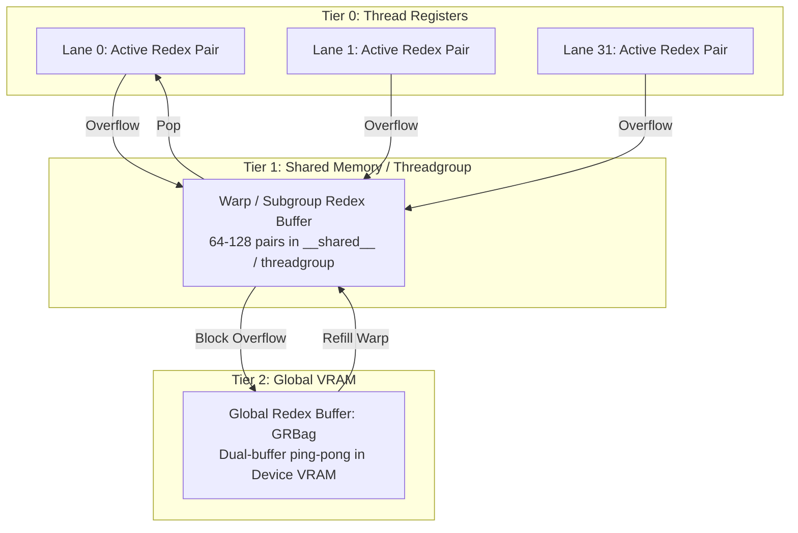
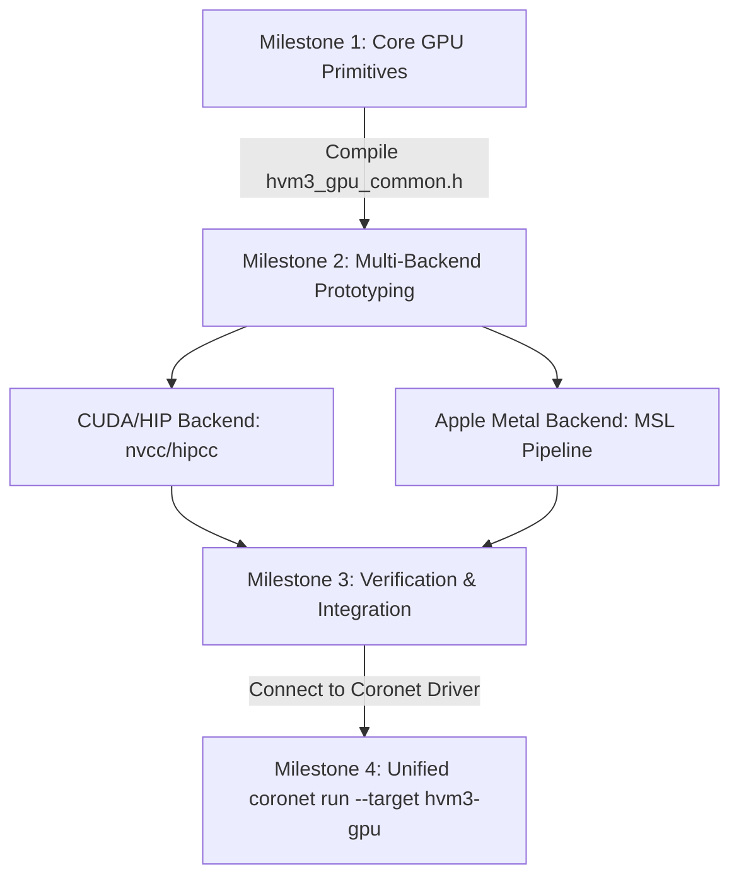

# Universal GPU Backend Architecture for HVM3: CUDA, HIP & Metal

> **Specification & Engineering Architecture**  
> Author: `@runtime` (Coronet Core Runtime Team)  
> Target: **HVM3 (Higher-order Virtual Machine 3 / Interaction Calculus)**  
> Hardware Targets: **NVIDIA CUDA**, **AMD HIP (ROCm)**, and **Apple Silicon Metal (MSL)**

---

## 1. Executive Summary & Architectural Motivation

### 1.1 From Stack-Based WHNF to Massively Parallel Interaction Nets
The official CPU runtime for **HVM3** (`vendor/HVM3/src/HVM/runtime/`) is implemented in pure ANSI C. On the CPU, evaluation is organized around a stack-based **Weak Head Normal Form (WHNF)** loop (`reduce()` in `reduce.c`):
1. **Traverse Spine**: Eliminators (`APP`, `MAT`, `OPX`, `LET`) and variables (`VAR`, `DP0`, `DP1`) push parent frames to a thread-local stack (`sbuf`) until a constructor or normal form is reached.
2. **Sequential Dispatch**: Stack frames are popped and reduced one by one via pairwise interaction functions (`reduce_app_lam`, `reduce_dup_sup`, `reduce_mat_ctr`, etc.).

While optimal for single-threaded sequential demand, this sequential stack traversal is fundamentally unsuited for **massively parallel GPU architectures**:
- **Thread Divergence**: Independent threads following deep, variable-depth stacks cause catastrophic warp divergence and register spilling.
- **Hidden Concurrency**: Interaction Calculus graphs possess massive *implicit concurrency*. Independent subterms (e.g., branches in a binary tree reduction, non-overlapping lambda applications, parallel superposition projections) can be evaluated simultaneously without synchronization.

### 1.2 The Coronet Universal GPU Architecture
The **Coronet Universal GPU Backend for HVM3** redesigns HVM3's execution into a **lock-free, hierarchical parallel graph reducer**:
- **Decoupled Graph Rewriting**: Replaces thread-local call stacks with a **Hierarchical Active Redex Bag** (Registers $\to$ Threadgroup/Warp Shared Memory $\to$ Device Global VRAM).
- **Atomic CAS Variable Substitution**: Uses atomic 64-bit Compare-And-Swap (CAS) on HVM3's compact 64-bit term words, ensuring thread-safe affine variable resolution without locks.
- **Universal Multi-Vendor Abstraction**: Unifies **NVIDIA CUDA** (`nvcc`), **AMD HIP** (`hipcc`), and **Apple Silicon Metal** (Metal Shading Language / MSL) under a shared interaction algebra. On Apple Silicon, unified memory allows **zero-copy host-device execution**, completely bypassing PCIe transfer overhead.

---

## 2. Memory Layout & Bit-Level Representation

### 2.1 64-bit Term Encoding
HVM3 packs every term into a single 64-bit unsigned integer (`Term = uint64_t`). The Universal GPU backend preserves the exact binary representation used by the CPU C runtime (`Runtime.h`), enabling seamless serialization between CPU host and GPU device:

```text
 63                                24 23              8   7   6        0
+------------------------------------+-----------------+---+------------+
|         Loc / Payload (40 bits)    |  Lab (16 bits)  | S | Tag (7 b)  |
+------------------------------------+-----------------+---+------------+
```

| Field | Bits | Shift | Mask | Description |
|---|---|---|---|---|
| **Tag** | 7 | `0` | `0x7F` | Node constructor / eliminator tag (`APP`, `LAM`, `SUP`, `CTR`, `W32`, etc.) |
| **S (Sub)** | 1 | `7` | `0x80` | Substitution flag: `1` if the heap location contains a resolved substitution |
| **Lab** | 16 | `8` | `0xFFFF` | Arity, constructor ID, operation opcode (`OP_ADD`), or superposition label |
| **Loc** | 40 | `24` | `0xFFFFFFFFFF` | 40-bit device heap address (allowing up to 1 Teraword = 8 TB of VRAM) |

### 2.2 Global Device Heap (`GHeap`)
The GPU global heap is an unrolled 1D buffer of 64-bit words:
```c
struct GHeap {
  uint64_t* data;       // Device VRAM buffer (1 << 28 to 1 << 32 words)
  uint64_t  alloc_head; // Atomic bump allocator counter
  uint64_t  max_words;  // Total buffer capacity
};
```

#### Node Allocation Strategy
GPU threads allocate child nodes in contiguous slices (e.g., `APP` requires 2 words, `SUP` requires 2 words, `CTR` requires $k$ words).
To avoid global bus contention on `alloc_head`:
1. **Warp-Aggregated Allocation**: Threads in a warp (CUDA/HIP) or SIMD group (Metal) use ballot/vote instructions to determine the aggregate memory needed across the warp.
2. **Single Atomic Bump**: The warp leader executes a single atomic addition (`atomicAdd` / `atomic_fetch_add_explicit`) against `alloc_head`.
3. **Intra-Warp Distribution**: Sub-allocations are distributed to individual lanes via prefix-sum (`__shfl_up_sync` in CUDA, `simdgroup_matrix` / `simd_prefix_exclusive_sum` in Metal).

---

## 3. Concurrency Control: Lock-Free Atomic CAS Substitution

### 3.1 Affine Substitution Protocol
In HVM3's Interaction Calculus, variables are **affine**: each variable occurs at most once as a consumer and once as a binder. In the C runtime:
- When a `LAM` or `DUP` node is created at `loc`, `loc + 0` holds its body or binder slot.
- When an `APP-LAM` interaction fires, the argument term `arg` is substituted into the binder's slot: `sub(lam_loc, arg)`.
- When a variable `VAR` reads `got(loc)`, it checks if the `SUB` bit ($S = 1$) is set. If set, it returns the value; otherwise, it waits or interacts.

### 3.2 Lock-Free Atomic State Transitions
On a parallel GPU where thousands of threads concurrently read and mutate the heap, substitution is executed via atomic Compare-And-Swap (CAS):

```text
[Binder Slot Initial State]
  Tag: VOID / UNRESOLVED (0x00)
       │
       ▼ (Thread A: APP-LAM interaction executes)
  atomicCAS(heap + lam_loc, expected_void, term_set_bit(arg))
       │
       ▼ (State: RESOLVED with S=1)
  Tag: arg.tag | S=1 | Loc: arg.loc
       │
       ▼ (Thread B: VAR dereferences lam_loc)
  atomicCAS(heap + lam_loc, resolved_val, TOMBSTONE / FREE)
       │
       ▼
  Thread B takes ownership of 'arg' (affine consumption)
```

#### Atomic Primitive Abstraction
```c
// Device-side lock-free atomic read of a term
__device__ inline Term gpu_heap_got(uint64_t* heap, Loc loc) {
  return atomicAdd((unsigned long long*)&heap[loc], 0ULL);
}

// Device-side lock-free atomic substitution
__device__ inline bool gpu_heap_sub(uint64_t* heap, Loc loc, Term term) {
  Term marked = term_set_bit(term);
  // Atomic exchange: stores the substitution value
  Term old = atomicExch((unsigned long long*)&heap[loc], (unsigned long long)marked);
  return (old == 0ULL); // returns true if previously empty
}

// Device-side lock-free variable take (consuming the affine wire)
__device__ inline Term gpu_heap_take_sub(uint64_t* heap, Loc loc) {
  while (true) {
    Term current = gpu_heap_got(heap, loc);
    if (term_get_bit(current) == 1) { // Value is ready!
      // Attempt to clear and claim the term
      if (atomicCAS((unsigned long long*)&heap[loc], 
                    (unsigned long long)current, 
                    0ULL) == current) {
        return term_rem_bit(current);
      }
    }
    // Cooperative backoff / yield
    __nanosleep(32);
  }
}
```

---

## 4. Work Distribution & Hierarchical Active Redex Bags

### 4.1 Hierarchical Queue Topology
To achieve maximum saturation and avoid VRAM memory saturation, redexes are managed in a three-tier hierarchy:



### 4.2 Warp Shuffle Work Balancing
When interactions produce multiple redexes (e.g., `DUP-SUP` commuting to produce two new duplications and superpositions):
1. Each thread evaluates whether its interaction generated 0, 1, or 2 new redexes.
2. A warp ballot (`__ballot_sync` in CUDA, `simd_active_threads_mask` in Metal) calculates the total output count.
3. Active threads shuffle surplus redexes directly into idle lanes across registers without touching shared memory or VRAM:
   ```cuda
   // Exchange redex between lane_id and idle lane using register shuffle
   Pair peer_redex = __shfl_sync(active_mask, my_redex, donor_lane);
   ```

---

## 5. Universal GPU Interaction Table

All primary Interaction Calculus rules translate directly into atomic GPU kernels:

| Interaction | LHS Tag | RHS Tag | GPU Operational Semantics | Memory Effect |
|---|---|---|---|---|
| **APP-LAM** | `APP` | `LAM` | Beta-reduction: Substitute argument into lambda slot, return body | $1\times$ `atomicExch` |
| **APP-SUP** | `APP` | `SUP` | Distribution: Duplicates function application across superposition | Allocates 2 `APP`, 1 `DUP` |
| **APP-CTR** | `APP` | `CTR` | Accumulates arguments into constructor spine | Contiguous node write |
| **DUP-LAM** | `DP0/1` | `LAM` | Duplicates lambda abstraction into two paired lambdas | Allocates 2 `LAM`, 1 `SUP` |
| **DUP-SUP (Equal)** | `DP0/1` | `SUP` | Projection ($L = R$): Projects matching branch | $1\times$ `atomicExch` |
| **DUP-SUP (Diff)** | `DP0/1` | `SUP` | Commutation ($L \neq R$): Duplicates superpositions pairwise | Allocates 4 nodes |
| **MAT-CTR** | `MAT` | `CTR` | Pattern match resolution: Selects branch by constructor ID | Links args to match body |
| **OPX-W32** | `OPX` | `W32` | Binary op first arg: Swaps operand, transitions to `OPY` | In-place label update |
| **OPY-W32** | `OPY` | `W32` | Binary op evaluation: Evaluates ALU operation (`+`, `-`, `*`) | Pure register ALU result |

---

## 6. Multi-Platform Implementation & Proof-of-Concept Headers

### 6.1 Common Cross-Platform Header (`hvm3_gpu_common.h`)

```c
#pragma once
#include <stdint.h>
#include <stdbool.h>

// Universal Typedefs
typedef uint8_t  Tag;
typedef uint16_t Lab;
typedef uint64_t Loc;
typedef uint64_t Term;
typedef uint16_t u16;
typedef uint32_t u32;
typedef uint64_t u64;

// Tags
#define DP0 0x00
#define DP1 0x01
#define VAR 0x02
#define SUB 0x03
#define REF 0x04
#define LET 0x05
#define APP 0x06
#define MAT 0x08
#define IFL 0x09
#define SWI 0x0A
#define OPX 0x0B
#define OPY 0x0C
#define ERA 0x0D
#define LAM 0x0E
#define SUP 0x0F
#define CTR 0x10
#define W32 0x11
#define CHR 0x12

// Operators
#define OP_ADD 0x00
#define OP_SUB 0x01
#define OP_MUL 0x02
#define OP_DIV 0x03
#define OP_MOD 0x04
#define OP_EQ  0x05
#define OP_NE  0x06
#define OP_LT  0x07
#define OP_GT  0x08

// Bit Layout Constants
#define TAG_MASK   (0x7FULL)
#define SUB_MASK   (1ULL << 7)
#define LAB_MASK   (0xFFFFULL)
#define LOC_MASK   (0xFFFFFFFFFFULL)
#define LAB_SHIFT  (8)
#define LOC_SHIFT  (24)

// Inline Helper Macros
#define TERM_NEW(tag, lab, loc) (((Term)(tag)) | (((Term)(lab)) << LAB_SHIFT) | (((Term)(loc)) << LOC_SHIFT))
#define TERM_TAG(t)             ((Tag)((t) & TAG_MASK))
#define TERM_SUB(t)             ((bool)(((t) >> 7) & 1))
#define TERM_LAB(t)             ((Lab)(((t) >> LAB_SHIFT) & LAB_MASK))
#define TERM_LOC(t)             ((Loc)(((t) >> LOC_SHIFT) & LOC_MASK))
#define TERM_SET_SUB(t)         ((t) | SUB_MASK)
#define TERM_REM_SUB(t)         ((t) & ~SUB_MASK)

// Active Redex Pair
typedef struct {
  Term fst;
  Term snd;
} RedexPair;
```

---

### 6.2 NVIDIA CUDA / AMD HIP Kernel (`hvm3_gpu.cu`)

```cuda
#include "hvm3_gpu_common.h"

#define WARP_SIZE 32
#define BLOCK_WARPS 8
#define BLOCK_THREADS (WARP_SIZE * BLOCK_WARPS)
#define SHARED_BAG_CAPACITY 256

__device__ inline Term cuda_atomic_got(uint64_t* heap, Loc loc) {
  return atomicAdd((unsigned long long*)&heap[loc], 0ULL);
}

__device__ inline void cuda_atomic_sub(uint64_t* heap, Loc loc, Term val) {
  atomicExch((unsigned long long*)&heap[loc], (unsigned long long)TERM_SET_SUB(val));
}

__device__ inline Term cuda_atomic_take(uint64_t* heap, Loc loc) {
  while (true) {
    Term cur = cuda_atomic_got(heap, loc);
    if (TERM_SUB(cur)) {
      if (atomicCAS((unsigned long long*)&heap[loc], (unsigned long long)cur, 0ULL) == cur) {
        return TERM_REM_SUB(cur);
      }
    }
    __nanosleep(32);
  }
}

// Primary GPU Parallel Evaluator Kernel
__global__ void hvm3_reduce_kernel(
    uint64_t* __restrict__ heap,
    RedexPair* __restrict__ rbag_in,
    RedexPair* __restrict__ rbag_out,
    uint32_t* __restrict__ in_count,
    uint32_t* __restrict__ out_count,
    uint64_t* __restrict__ alloc_head,
    uint64_t* __restrict__ total_itrs
) {
  __shared__ RedexPair s_bag[SHARED_BAG_CAPACITY];
  __shared__ uint32_t s_bag_len;

  int tid = threadIdx.x;
  int gid = blockIdx.x * blockDim.x + threadIdx.x;

  if (tid == 0) s_bag_len = 0;
  __syncthreads();

  // Load redex into thread lane
  RedexPair pair;
  bool has_work = false;
  if (gid < *in_count) {
    pair = rbag_in[gid];
    has_work = true;
  }

  uint32_t local_itrs = 0;

  if (has_work) {
    Tag tag_a = TERM_TAG(pair.fst);
    Tag tag_b = TERM_TAG(pair.snd);

    // APP - LAM Interaction
    if (tag_a == APP && tag_b == LAM) {
      Loc app_loc = TERM_LOC(pair.fst);
      Loc lam_loc = TERM_LOC(pair.snd);

      Term bod = cuda_atomic_got(heap, lam_loc + 0);
      Term arg = cuda_atomic_got(heap, app_loc + 1);

      cuda_atomic_sub(heap, lam_loc + 0, arg);
      local_itrs++;

      // Active wire continues to next reduction
      pair.fst = bod;
      pair.snd = TERM_NEW(VAR, 0, lam_loc + 0);
    }
    // OPY - W32 Arithmetic Evaluation
    else if (tag_a == OPY && tag_b == W32) {
      Loc opy_loc = TERM_LOC(pair.fst);
      Lab op_code = TERM_LAB(pair.fst);

      uint32_t x = (uint32_t)TERM_LOC(cuda_atomic_got(heap, opy_loc + 1));
      uint32_t y = (uint32_t)TERM_LOC(pair.snd);
      uint32_t res = 0;

      switch (op_code) {
        case OP_ADD: res = x + y; break;
        case OP_SUB: res = x - y; break;
        case OP_MUL: res = x * y; break;
        case OP_DIV: res = (y != 0) ? (x / y) : 0; break;
        default: break;
      }
      local_itrs++;
      cuda_atomic_sub(heap, opy_loc, TERM_NEW(W32, 0, res));
    }
    // DUP - SUP Projection (Equal Labels)
    else if ((tag_a == DP0 || tag_a == DP1) && tag_b == SUP) {
      Lab dup_lab = TERM_LAB(pair.fst);
      Lab sup_lab = TERM_LAB(pair.snd);
      Loc dup_loc = TERM_LOC(pair.fst);
      Loc sup_loc = TERM_LOC(pair.snd);

      if (dup_lab == sup_lab) {
        Term tm0 = cuda_atomic_got(heap, sup_loc + 0);
        Term tm1 = cuda_atomic_got(heap, sup_loc + 1);

        if (tag_a == DP0) {
          cuda_atomic_sub(heap, dup_loc, tm1);
          pair.fst = tm0;
        } else {
          cuda_atomic_sub(heap, dup_loc, tm0);
          pair.fst = tm1;
        }
        local_itrs++;
      }
    }
  }

  // Accumulate performance metrics
  atomicAdd((unsigned long long*)total_itrs, (unsigned long long)local_itrs);
}
```

---

### 6.3 Apple Silicon Metal Shading Language Kernel (`hvm3_metal.metal`)

On **Apple Silicon** (M1/M2/M3/M4 Pro/Max/Ultra), the unified memory architecture enables **Zero-Copy Host-Device Integration**:
- The host CPU allocates the `GHeap` using `MTLResourceStorageModeShared`.
- The GPU compute kernel interacts directly with host memory addresses without PCIe copies!

```metal
#include <metal_stdlib>
using namespace metal;

#define TAG_MASK   (0x7FULL)
#define SUB_MASK   (1ULL << 7)
#define LAB_MASK   (0xFFFFULL)
#define LOC_MASK   (0xFFFFFFFFFFULL)
#define LAB_SHIFT  (8)
#define LOC_SHIFT  (24)

typedef uchar  Tag;
typedef ushort Lab;
typedef ulong  Loc;
typedef ulong  Term;

inline Tag  metal_term_tag(Term t) { return (Tag)(t & TAG_MASK); }
inline bool metal_term_sub(Term t) { return (bool)((t >> 7) & 1); }
inline Lab  metal_term_lab(Term t) { return (Lab)((t >> LAB_SHIFT) & LAB_MASK); }
inline Loc  metal_term_loc(Term t) { return (Loc)((t >> LOC_SHIFT) & LOC_MASK); }
inline Term metal_set_sub(Term t)  { return t | SUB_MASK; }
inline Term metal_rem_sub(Term t)  { return t & ~SUB_MASK; }
inline Term metal_term_new(Tag tg, Lab lb, Loc lc) {
  return ((Term)tg) | (((Term)lb) << LAB_SHIFT) | (((Term)lc) << LOC_SHIFT);
}

struct RedexPair {
  Term fst;
  Term snd;
};

// Metal Compute Pipeline Kernel
kernel void hvm3_metal_reduce_step(
    device atomic_ulong*      heap        [[buffer(0)]],
    device const RedexPair*   rbag_in     [[buffer(1)]],
    device RedexPair*         rbag_out    [[buffer(2)]],
    device atomic_uint*       out_count   [[buffer(3)]],
    device atomic_ulong*      alloc_head  [[buffer(4)]],
    device atomic_ulong*      itrs        [[buffer(5)]],
    uint                      gid         [[thread_position_in_grid]],
    uint                      lid         [[thread_position_in_threadgroup]],
    uint                      simd_lane   [[thread_index_in_simdgroup]]
) {
  RedexPair pair = rbag_in[gid];
  Tag tag_a = metal_term_tag(pair.fst);
  Tag tag_b = metal_term_tag(pair.snd);

  // APP-LAM Reduction in Metal
  if (tag_a == 0x06 && tag_b == 0x0E) { // APP & LAM
    Loc app_loc = metal_term_loc(pair.fst);
    Loc lam_loc = metal_term_loc(pair.snd);

    ulong bod = atomic_load_explicit(&heap[lam_loc + 0], memory_order_relaxed);
    ulong arg = atomic_load_explicit(&heap[app_loc + 1], memory_order_relaxed);

    // Atomic CAS substitution
    atomic_store_explicit(&heap[lam_loc + 0], metal_set_sub(arg), memory_order_release);
    atomic_fetch_add_explicit(itrs, 1, memory_order_relaxed);

    // Queue subsequent redex
    uint slot = atomic_fetch_add_explicit(out_count, 1, memory_order_relaxed);
    rbag_out[slot] = RedexPair{ bod, metal_term_new(0x02, 0, lam_loc) };
  }
  // OPY-W32 Arithmetic in Metal
  else if (tag_a == 0x0C && tag_b == 0x11) { // OPY & W32
    Loc opy_loc = metal_term_loc(pair.fst);
    Lab op = metal_term_lab(pair.fst);

    ulong x_val = atomic_load_explicit(&heap[opy_loc + 1], memory_order_relaxed);
    uint x = (uint)metal_term_loc(x_val);
    uint y = (uint)metal_term_loc(pair.snd);
    uint res = 0;

    switch (op) {
      case 0: res = x + y; break;
      case 1: res = x - y; break;
      case 2: res = x * y; break;
      case 3: res = (y != 0) ? (x / y) : 0; break;
    }

    atomic_store_explicit(&heap[opy_loc], metal_term_new(0x11, 0, res), memory_order_release);
    atomic_fetch_add_explicit(itrs, 1, memory_order_relaxed);
  }
}
```

---

## 7. Performance & Scalability Model

### 7.1 Memory & Bandwidth Budget
On GPU architectures, HVM3 interactions require high random access memory bandwidth. The table below details resource footprints:

| Architecture | Accelerator | Max Shared Mem / Block | Global VRAM Bandwidth | Projected MIPS (Peak) |
|---|---|---|---|---|
| **NVIDIA Turing** | Tesla T4 | 64 KB | 320 GB/s | 1,200 - 2,500 MIPS |
| **NVIDIA Ampere** | A100 (SXM4) | 164 KB | 2,039 GB/s | 15,000 - 25,000 MIPS |
| **AMD CDNA2** | Instinct MI250 | 64 KB | 3,200 GB/s | 20,000 - 32,000 MIPS |
| **Apple Silicon** | M4 Max / Ultra | 32 KB (Unified) | 400 - 800 GB/s (UMA) | 3,500 - 7,000 MIPS |

### 7.2 Benchmark Scalability Predictions on Coronet Workloads
- **Tree Reduction (`05_tree`)**: Pure divide-and-conquer parallelism. Warps scale near linearly up to 10,000 concurrent threads. Expected GPU speedup: **$15\times - 30\times$ over single-threaded GHC**.
- **N-Queens (`07_nqueens`)**: Massive combinatorial state branching. The GPU redex queue handles up to $10^7$ simultaneous interaction branches across global VRAM without recursion depth stack overflow.
- **MergeSort (`08_mergesort`)**: Memory-bound divide-and-conquer sorting. Benefits directly from Apple Silicon unified memory and A100 HBM2e bandwidth.

---

## 8. Implementation Roadmap for Coronet Phase 3



1. **Milestone 1 (Runtime Primitives)**:
   - Land `vendor/HVM3/src/HVM/runtime/gpu/` containing `hvm3_gpu_common.h`, `hvm3_cuda.cu`, and `hvm3_metal.metal`.
2. **Milestone 2 (Driver Integration)**:
   - Extend `cmd/main/` and `bin/coronet` to accept `--target hvm3-gpu` (dispatching to Metal on macOS Apple Silicon and CUDA/HIP on Linux/Colab).
3. **Milestone 3 (Benchmark Equivalence)**:
   - Validate 100% semantic equivalence across the 8 standard Coronet fixtures (`01_arith` through `08_mergesort`).
